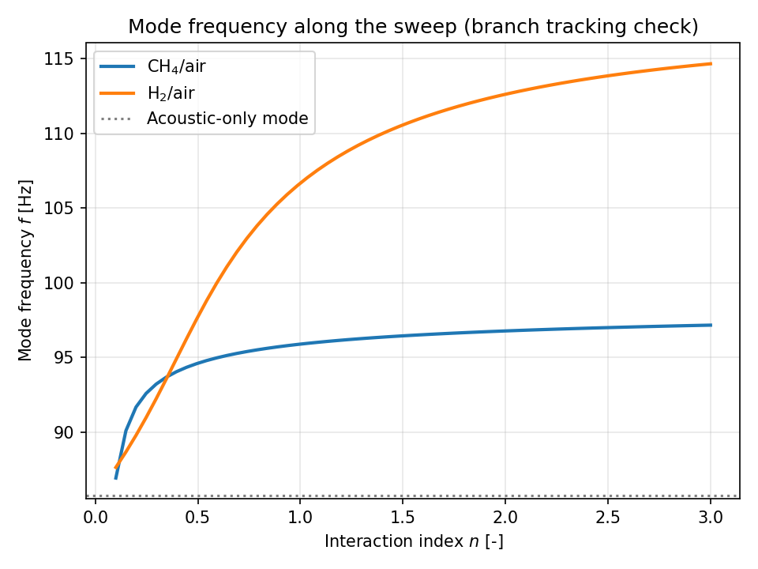

# ThermoAcoustic-H2

Low-order thermoacoustic stability modeling of a Rijke-type tube with a
compact premixed flame, used to compare CH4/air and H2/air. The flame
response is described by Crocco's n-tau model, with the time delay tau
calibrated from Cantera laminar flame speeds.

## Context

This is a personal research project exploring the coupling between acoustics
and combustion, with a focus on what a switch to hydrogen could mean for
combustion instabilities in aviation gas turbines. It is a low-order study,
not a high-fidelity simulation: its value lies in the physical formulation,
the validation of each building block, and the quality of the code.

## Architecture

- `src/thermoacoustic/acoustics.py` — acoustic network elements (ducts, boundary conditions)
- `src/thermoacoustic/flame.py` — n-tau flame model, compact flame element, and `FlameCalibrator` (tau from Cantera)
- `src/thermoacoustic/solver.py` — network assembly and characteristic equation
- `src/thermoacoustic/stability.py` — growth rate and Rayleigh index analysis
- `src/thermoacoustic/config.py` — YAML configuration loading and validation
- `configs/` — one YAML file per fuel case
- `scripts/` — validation and study scripts
- `docs/formulation.md` — physical formulation, validation details, limitations

## Installation

```bash
pip install -e ".[dev]"
```

## Usage

```bash
# Flame calibration (Cantera) — validates flame speed and adiabatic temperature
python scripts/cantera_reference_case.py

# Acoustic-only validation — validates eigenfrequencies of a closed-open duct
python scripts/validate_acoustics.py

# Thermoacoustic coupling — CH4 vs H2 growth rate comparison and Rayleigh check
python scripts/validate_flame_coupling.py
```

The coupling study (`validate_flame_coupling.py`) reads all its parameters
(fuel, geometry, flame model, sweep range) from the YAML files in
`configs/`. The two validation scripts reproduce fixed reference cases
(analytical duct modes, published flame speed) and keep their parameters
in the script by design.

## Testing

```bash
pytest tests/ -v
```

The test suite covers the acoustic elements and boundary conditions, the
solver (first eigenfrequency against the analytical closed-open duct value),
the YAML configuration loader and its consistency checks, and the stability
analysis (the sign of the Rayleigh index must match the sign of the growth
rate).

## Results

### Flame calibration (Cantera)

Laminar flame speed and adiabatic flame temperature of a stoichiometric
CH4/air mixture, computed with GRI-Mech 3.0 at T = 298.15 K and
p = 101325 Pa, matching the conditions of the literature references.

| Quantity | This work | Reference |
|---|---|---|
| Laminar flame speed | 0.38 m/s | 0.36 m/s ± 0.017 m/s (Vagelopoulos & Egolfopoulos, 1998) |
| Adiabatic flame temperature | 2229.5 K | 2224.3 K (independent Cantera/GRI-Mech 3.0 cross-check, arXiv:2503.11826) |

> Vagelopoulos, C. M., & Egolfopoulos, F. N. (1998). Direct experimental
> determination of laminar flame speeds. *Proceedings of the Combustion
> Institute*, 27, 513-519.

The ~5.6% discrepancy on flame speed is consistent with GRI-Mech 3.0's known
tendency to slightly overpredict flame speed near stoichiometry, and with
the typical scatter between experimental techniques (±2-3 cm/s). The
adiabatic temperature agrees within 0.2%. Grid independence was verified
through a convergence study (34 → 139 → 253 points); see
`docs/formulation.md` for the full table.

### Acoustic network validation

The transfer-matrix acoustic solver was validated against the analytical
eigenfrequencies of a closed-open duct (L = 1 m, c = 343 m/s): all 6
computed modes agree with theory within 0.3%.

### Thermoacoustic coupling and fuel comparison

A compact flame element (Crocco's n-tau model) is coupled to the acoustic
network, making the eigenvalue problem complex: each mode carries a growth
rate sigma = -Im(omega), with sigma > 0 indicating instability.

The time delay is estimated as a convective transit time, tau = d / S_L,
with S_L from Cantera and d = 10 mm:

| Fuel | phi | S_L [m/s] | tau [ms] |
|---|---|---|---|
| CH4/air | 1.0 | 0.38 | 26.64 |
| H2/air | 0.9 | 2.00 | 4.99 |

The interaction index n is **not** calibrated: it is swept as a free
parameter. Sweeping n at each fuel's calibrated tau gives:


Both fuels become unstable above a threshold. Hydrogen crosses later
(n ~ 0.6 against n ~ 0.4 for methane) but its growth rate rises roughly
three times faster once unstable (+167 against +58 1/s at n = 3). In
engineering terms: in this configuration hydrogen is not more prone to
instability, but the instability it produces is considerably more violent.

The frequency of the tracked mode stays smooth and monotonic along both
sweeps, confirming that the solver remains on the fundamental mode:



The Rayleigh index, computed from the pressure and heat-release fluctuations
of the eigenmode, agrees in sign with the growth rate for both fuels.

**Methodological note.** An initial attempt at a 2D (n, tau) stability map
was discarded. Newton's method on this transcendental characteristic
equation does not guarantee branch tracking, and the map silently drifted
onto a spurious mode. The error was found by cross-checking against direct
1D sweeps, which are used for all results above. See
`docs/formulation.md` (Section 3.4) for the full diagnosis.

## Limitations

This is a low-order model, and its quantitative reach is limited:

- **No damping.** The open end is idealized and no losses are modelled, so
  the flame alone sets the stability boundary. Realistic losses would raise
  both thresholds and could change their ordering.
- **Uniform mean temperature.** Both ducts share the same speed of sound,
  whereas the temperature jumps by a factor of ~7 across a real flame.
- **Uncalibrated parameters.** The interaction index n, the coupling factor
  and the convective length d are not derived from physics. The absolute
  position of the thresholds therefore carries no quantitative weight; only
  the comparison between the two fuels, computed under identical
  assumptions, is meaningful.

See `docs/formulation.md` for the derivation, the calibration, and the
complete list of assumptions.