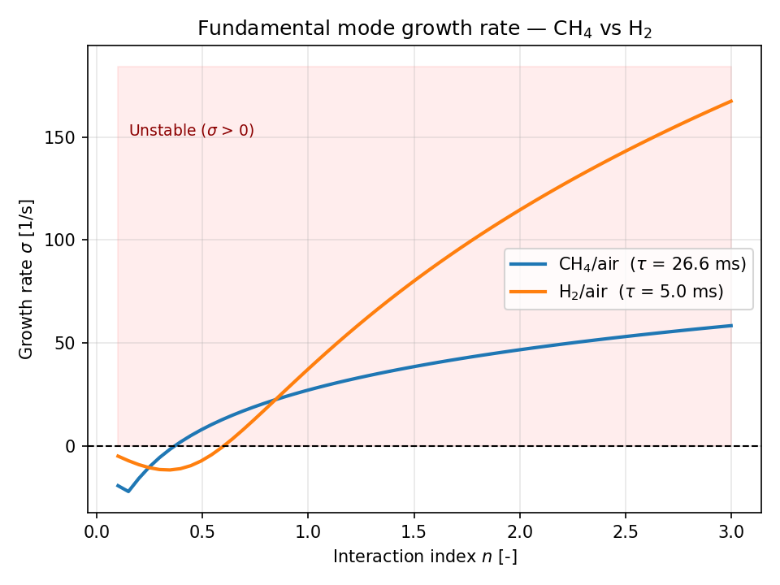

# ThermoAcoustic-H2

Low-order thermoacoustic stability modeling for premixed CH4/air and H2/air flames
in a Rijke-tube-type configuration. The network acoustic model (n-tau flame response)
is calibrated against Cantera laminar flame calculations to compare the stability
behavior of methane and hydrogen combustion.

## Context

This project was developed as a personal research project to explore the coupling
between acoustics and combustion, with a focus on the stability implications of
hydrogen as an alternative fuel for aviation gas turbines.

## Architecture

- `src/thermoacoustic/acoustics.py` — acoustic network elements (ducts, junctions, boundaries)
- `src/thermoacoustic/flame.py` — flame response models (n-tau / Crocco's law)
- `src/thermoacoustic/solver.py` — network assembly and eigenvalue solver
- `src/thermoacoustic/stability.py` — (planned) Rayleigh criterion and fuel comparison tools

## Installation

```bash
pip install -e .
```

## Usage

```bash
# Flame calibration (Cantera) — validates flame speed and adiabatic temperature
python scripts/cantera_reference_case.py

# Acoustic-only validation — validates eigenfrequencies of a closed-open duct
python scripts/validate_acoustics.py

# Full thermoacoustic coupling — n-tau flame model, stability map, Rayleigh check
python scripts/validate_flame_coupling.py

```
## Testing

Unit tests cover the acoustic elements (transfer matrix, boundary
conditions) and validate the solver's first eigenfrequency against the
analytical value for a closed-open duct:

```bash
pytest tests/ -v
```

## Results

### Flame calibration (Cantera)

Laminar flame speed and adiabatic flame temperature of a stoichiometric
CH4/air mixture, computed with GRI-Mech 3.0. For validation purposes, this
calculation was run at T = 298.15 K and p = 101325 Pa to exactly match the conditions of the
literature references used for comparison.

| Quantity | This work (T=298.15K) | Reference |
|---|---|---|
| Laminar flame speed | 0.38 m/s | 0.36 m/s ± 0.017 m/s (Vagelopoulos & Egolfopoulos, 1998) |
| Adiabatic flame temperature | 2229.5 K | 2224.3 K (independent Cantera/GRI-Mech 3.0 cross-check, arXiv:2503.11826) |

> Vagelopoulos, C. M., & Egolfopoulos, F. N. (1998). Direct experimental
> determination of laminar flame speeds. *Proceedings of the Combustion
> Institute*, 27, 513-519.

The ~5.6% discrepancy on flame speed is consistent with GRI-Mech 3.0's known
tendency to slightly overpredict flame speed near stoichiometry, and with
the typical scatter between experimental techniques reported in the
literature (±2-3 cm/s). The adiabatic temperature agrees within 0.2%.

Grid-independence was verified through a convergence study (34 → 139 → 253
points). See `docs/formulation.md` for the full convergence table and
discussion.

### Acoustic network validation

The transfer-matrix acoustic solver was validated against the analytical
eigenfrequencies of a closed-open duct (L=1m, c=343 m/s): all 6 computed
modes agree with theory within 0.3%. See `docs/formulation.md` for the
full comparison table.


### Thermoacoustic coupling and fuel comparison

A compact flame element (Crocco's n-tau model) is coupled to the acoustic
network, making the eigenvalue problem complex: each mode carries a growth
rate sigma = -Im(omega), with sigma > 0 indicating instability.

The time delay tau is calibrated from Cantera laminar flame speeds
(tau = d / S_L, with d = 10 mm):

| Fuel | phi | S_L [m/s] | tau [ms] |
|---|---|---|---|
| CH4/air | 1.0 | 0.38 | 26.64 |
| H2/air | 0.9 | 2.00 | 4.99 |

Sweeping the interaction index n at each fuel's calibrated tau:



Both fuels become unstable above a threshold. Hydrogen crosses later
(n ~ 0.60 vs n ~ 0.37 for methane) but grows roughly three times faster
once unstable (+167 vs +58 1/s at n = 3). The Rayleigh index was computed
independently and agrees in sign with the eigenvalue solver in both cases.

**Methodological note**: an initial attempt at a 2D (n, tau) stability map
was discarded. Newton's method on this transcendental characteristic
equation does not guarantee branch tracking, and the map silently drifted
onto a spurious mode beyond n ~ 0.9. The error was found by cross-checking
against direct 1D sweeps, which are used for all results above. See
`docs/formulation.md` (Section 3.4) for the full diagnosis.

See `docs/formulation.md` (Section 3) for the derivation, the calibration,
and the limitations — in particular the absence of damping and the uniform
mean temperature assumption.

## Limitations

This is a low-order model, not a high-fidelity LES — see `docs/formulation.md` for
the full list of assumptions.
