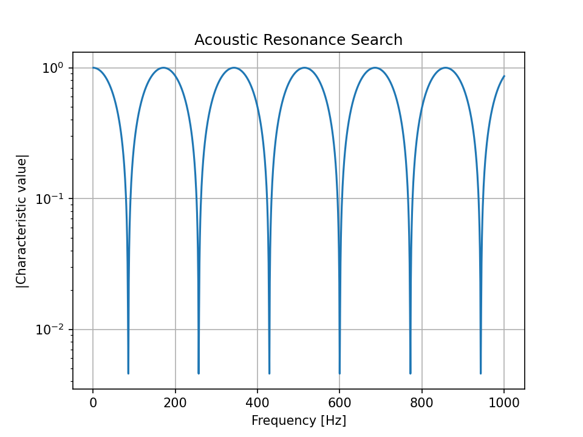
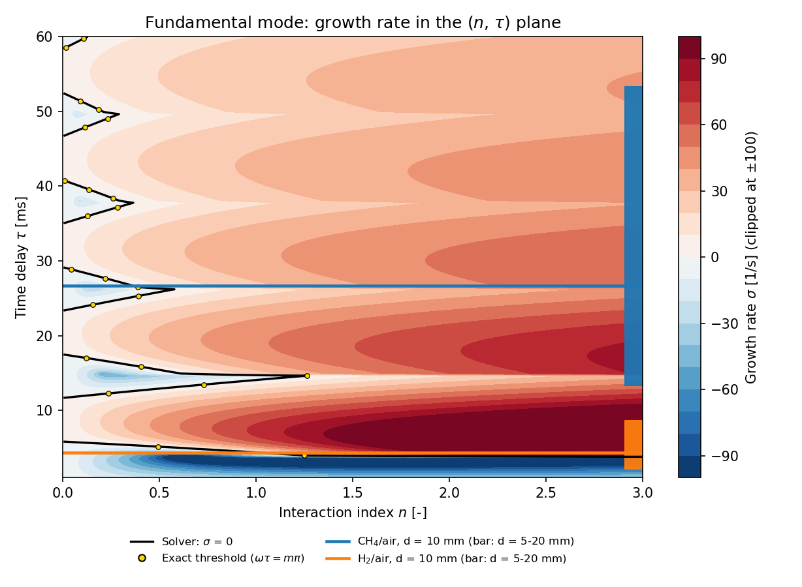
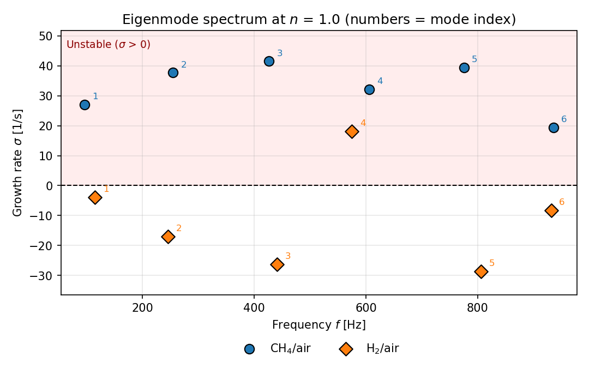
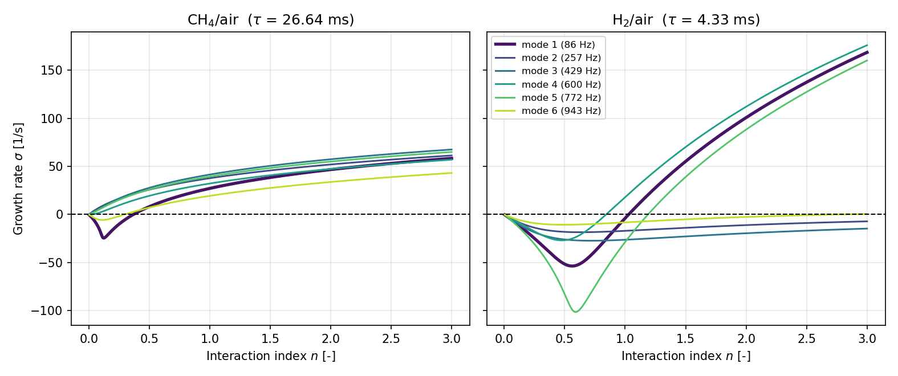

# Physical Formulation

This document states the physical model behind the code, the checks each
building block has passed, and the limits of what the results can claim.

Two kinds of checks are distinguished throughout. **Verification** asks
whether the code solves the model's equations correctly (analytical
solutions, limiting cases, convergence). **Validation** asks whether the
model represents reality (measurements, published results). The flame speeds are compared with compiled measurements: methane agrees
within the quoted uncertainty, and the 9.5 % excess of hydrogen is explained
by the transport model (Section 1). The acoustic and coupled solvers are verified against analytical
results. The coupled model as a whole has not been validated against an
external thermoacoustic reference.

## 1. Chemical kinetics and laminar flame calibration

The laminar flame speed S_L and the adiabatic flame temperature of CH4/air
and H2/air mixtures are computed with Cantera, using a freely propagating
premixed flame (`FreeFlame`). GRI-Mech 3.0 (`gri30.yaml`) is used for
methane and the `h2o2.yaml` mechanism shipped with Cantera for hydrogen.

All calculations use fresh gas at T = 298.15 K (25 °C) and p = 1 atm
(101325 Pa), the standard conditions of the combustion literature.

Only one quantity is carried from the chemistry into the thermoacoustic
model: S_L, which sets the flame time delay τ (Section 3.5).

### Reference case: CH4/air, φ = 1.0, T = 298.15 K, p = 1 atm

| Quantity | Value |
|---|---|
| Laminar flame speed S_L | 0.375 m/s |
| Adiabatic flame temperature | 2229.5 K |

### Numerical setup

- Domain width: 0.03 m
- Refinement criteria: `ratio=3`, `slope=0.05`, `curve=0.05`
- Solved with `auto=True` (staged energy-off / energy-on / refine)

### Grid convergence study

The study was run at T = 300 K, before the fresh-gas conditions were aligned
with the literature (298.15 K). The reference case above was then recomputed
at 298.15 K on the converged 253-point grid.

| Grid points | Refinement criteria | S_L [m/s] | Adiabatic T [K] |
|---|---|---|---|
| 34 | Cantera default | 0.42 | 2225.8 |
| 139 | ratio=3, slope=curve=0.1 | 0.38 | 2229.3 |
| 253 | ratio=3, slope=curve=0.05 | 0.38 | 2230.4 |

S_L is identical between the 139- and 253-point grids to the two digits
recorded, which confirms grid independence. The default criteria (34
points) under-resolve the flame front and overpredict S_L by about 10 %.

The adiabatic temperature varies by 0.2 % across the three grids. It is a
global energy-balance quantity, nearly independent of the local
discretisation, whereas S_L depends on gradients and reaction rates inside
the thin flame front, which require a finer mesh.

### Comparison with measurements

**Methane.** For CH4/air at φ = 1.0, 298 K and 1 atm, a compilation of
twelve experimental studies gives S_L = 0.36 ± 0.017 m/s (Reference 1, which
includes Vagelopoulos & Egolfopoulos, 1998). The computed value, 0.375 m/s,
is 4.3 % higher (+1.5 cm/s), within the quoted uncertainty.

**Hydrogen.** For H2/air at φ = 1.0, 298 K and 1 atm, a compilation of nine
studies gives S_L = 2.112 ± 0.110 m/s (Reference 5). The computed value,
2.311 m/s, is 9.5 % higher (+20 cm/s), 1.8 times the quoted uncertainty.

Several explanations were tested (`scripts/transport_check.py`):

| Setting | CH4/air S_L [m/s] | H2/air S_L [m/s] |
|---|---|---|
| Project calculation (mixture-averaged transport) | 0.375 | 2.311 |
| Stricter refinement criteria | 0.374 | 2.311 |
| Wider domain (0.10 m) | 0.376 | 2.313 |
| Multicomponent transport | 0.377 | 2.270 |
| Multicomponent transport + thermal diffusion (Soret) | 0.372 | 2.088 |
| Compiled measurement | 0.360 ± 0.017 | 2.112 ± 0.110 |

Numerical settings change S_L by less than 0.5 %, and `h2o2.yaml` (the
hydrogen-oxygen submechanism of GRI-Mech 3.0) gives the same value as the
full GRI-Mech 3.0 (2.311 m/s), so the gap is neither a resolution nor a
mechanism-size effect. The transport model is what matters for hydrogen:
with multicomponent transport and thermal diffusion, the computed value is
1.1 % below the measurement, within its uncertainty. Hydrogen is very light
and diffuses much faster than the other species, which is the likely reason
for this sensitivity. For methane, the transport model changes S_L by about
1 %. Only one mechanism was tested.

The project keeps Cantera's default mixture-averaged transport for both
fuels, so that they are treated identically. The effect of the more complete
model on the stability thresholds is given in Section 3.8. The 0.15 K
difference between 298.0 K (compilations) and 298.15 K (calculations)
changes S_L by less than 0.1 %.

### Cross-check of the adiabatic temperature

The computed flame temperature (2229.5 K) differs by 0.23 % from the
equilibrium temperature of 2224.3 K obtained with the same mechanism and
software in an independent study (Reference 2, which compares it with the
NASA CEA tool). Because the mechanism and the software are the same, this
checks the implementation, not the mechanism.

As a physical sanity check, the result is about 100 K below a complete
combustion estimate that ignores dissociation (2325.6 K, Reference 3). This
is expected: at flame temperature, dissociation of the products (CO, OH, H,
O) absorbs energy and lowers the equilibrium temperature.

## 2. Acoustic model

The acoustic field is described by 1D linear acoustics with no mean flow and
a time dependence exp(iωt). At any point, the state is the pair (p, u) of
acoustic pressure and velocity. A duct of length L maps the state at its
inlet to the state at its outlet through a 2x2 transfer matrix:

```
[p]       [ cos(kL)          -i Z sin(kL) ] [p]
[u]_out = [ -i sin(kL) / Z    cos(kL)     ] [u]_in
```

with k = ω/c the wavenumber and Z = ρc the characteristic impedance.

Boundary conditions take the form a·p + b·u = 0:

- Closed end (rigid wall): u = 0, (a, b) = (0, 1)
- Open end (idealised, no end correction or radiation impedance): p = 0,
  (a, b) = (1, 0)

A state satisfying the inlet condition is propagated through all elements,
and eigenfrequencies are the values of ω at which the outlet condition is
also satisfied (the characteristic equation). For a single closed-open duct
it reduces to cos(kL) = 0.

### Verification: closed-open duct

For a duct of L = 1 m and c = 343 m/s the analytical eigenfrequencies are
f_n = (2n − 1) c / (4L). They were located by sweeping the frequency from 1
to 1000 Hz in 1 Hz steps and detecting the minima of the characteristic
value's magnitude.

| Mode | Numerical [Hz] | Analytical [Hz] | Relative error [%] |
|---|---|---|---|
| 1 | 86.0 | 85.75 | 0.292 |
| 2 | 257.0 | 257.25 | 0.097 |
| 3 | 429.0 | 428.75 | 0.058 |
| 4 | 600.0 | 600.25 | 0.042 |
| 5 | 772.0 | 771.75 | 0.032 |
| 6 | 943.0 | 943.25 | 0.027 |



The absolute error is exactly 0.25 Hz in every row: each mode is found at the
nearest point of the 1 Hz sweep grid. The table therefore measures the grid
resolution, not the accuracy of the solver, which is refined by root-finding
in Section 3.3. This verifies the acoustic building block in isolation.

## 3. Flame response model and thermoacoustic coupling

### 3.1 Crocco's n-τ model

The heat-release fluctuation Q' of the flame follows the upstream acoustic
velocity u' with a time delay τ and a gain n:

```
Q'(t) = n · u'(t − τ)        ->        Q'(ω) = n · exp(−iωτ) · u'(ω)
```

Q' is expressed in the normalised form in which it enters the velocity jump
below.

### 3.2 Compact flame element and characteristic equation

The flame is compact (zero thickness). Pressure is continuous across it and
the velocity jumps in proportion to Q':

```
p_out = p_in
u_out = u_in + cf · n · exp(−iωτ) · u_in  =  (1 + ξ) u_in,     ξ = cf · n · exp(−iωτ)
```

where cf is a coupling factor, set to 1. The model depends on n and cf only
through their product, so sweeping n at cf = 1 spans the whole family. The
transfer matrix is diag(1, 1 + ξ).

For a closed-open tube of length L = L1 + L2 with the flame at x = L1,
propagating the inlet state (p, u) = (1, 0) through the first duct, the
flame and the second duct, and imposing p = 0 at the outlet, gives

```
F(ω) = cos(kL) − ξ · sin(k L1) · sin(k L2) = 0
```

For ξ = 0 this is cos(kL) = 0, the acoustic eigenfrequencies.

Eigenfrequencies of the coupled system are complex. With the exp(iωt)
convention, a mode evolves as exp(σt) with σ = −Im(ω): σ > 0 is unstable,
σ < 0 is stable. Roots are found with Newton's method
(`scipy.optimize.newton`), started near the acoustic-only eigenfrequency and
updated progressively along a parameter sweep.

### 3.3 Consistency check: n = 0

With n = 0 the flame does not respond and the acoustic-only eigenfrequency
must be recovered with zero growth rate.

| Case | ω [rad/s] | f [Hz] | σ |
|---|---|---|---|
| Acoustic-only (Section 2) | 538.78 | 85.75 | 0 |
| Coupled, n = 0 | 538.78 − 3.8e−21 i | 85.75 | ≈ 0 (rounding) |

### 3.4 Eigenvalue tracking: a methodological caveat

F(ω) = 0 is transcendental and has infinitely many roots in the complex
plane, one family per acoustic mode, further multiplied by the delay term
exp(−iωτ). Newton's method returns the root in whose basin of attraction the
starting point lies, with no guarantee that successive solves stay on the
same physical branch.

An attempt to build a 2D stability map over the (n, τ) plane failed for this
reason. A second attempt used nearest-neighbour continuation and rejected
steps changing Re(ω) by more than 15 %. It converged at every point and
looked smooth, but it was a mosaic of different modes: the jump detector
catches abrupt changes, not a gradual drift onto another branch. The map was
cross-checked against a direct sweep along n at the same τ (4.99 ms, a grid
value of the map):

| n | Map: f [Hz] | Map: σ [1/s] | Direct: f [Hz] | Direct: σ [1/s] |
|---|---|---|---|---|
| 0.100 | 87.62 | −5.09 | 87.62 | −5.09 |
| 0.514 | 98.08 | −6.25 | 98.08 | −6.25 |
| 0.929 | rejected | — | 105.82 | +30.47 |
| 1.964 | 47.06 | −174.72 | 112.51 | +112.36 |
| 3.000 | 41.64 | −144.60 | 114.67 | +167.54 |

The two agree to the digits shown at low n, then diverge. The frequency
column identifies the cause: the map drifts to 41–47 Hz, a spurious branch
unrelated to the fundamental mode at 85.75 Hz, while the direct sweep stays
at 88–115 Hz.

The 2D map was discarded. All results come from 1D sweeps with continuation
along a single parameter, with the real part of ω monitored as a
branch-tracking check. A corrected map is given in Section 3.8: each of its
rows is an independent 1D continuation started next to the acoustic mode, and
no root is ever carried from one row to the next.

### 3.5 Flame calibration from chemistry

The time delay is estimated as a convective transit time,

```
τ = d / S_L
```

with S_L from Cantera (Section 1) and d a characteristic convective length,
taken as 10 mm for both fuels.

| Fuel | φ | S_L [m/s] | τ [ms] |
|---|---|---|---|
| CH4/air | 1.0 | 0.375 | 26.64 |
| H2/air | 1.0 | 2.311 | 4.33 |

The ratio τ(CH4)/τ(H2) = S_L(H2)/S_L(CH4) = 6.2 (5.9 with the measured flame speeds) is fixed by the chemistry
and does not depend on d, since d is common to both fuels. Both fuels are
computed at the same equivalence ratio, and the configuration check refuses
a comparison at different ones. S_L is the only quantity derived from
chemistry. The interaction index n and the length d are not calibrated.

### 3.6 Analytical verification of the coupled solver

Two exact consequences of F(ω) = 0 serve as tests of the solver. They are
part of the test suite (`tests/test_coupling_limits.py`).

**Exact stability threshold.** For real ω, cos(kL), sin(k L1) and sin(k L2)
are real, so Im F = cf · n · sin(ωτ) · sin(k L1) · sin(k L2). A neutral mode
therefore requires sin(ωτ) = 0, i.e. ωτ = mπ with m an integer. Then
ξ = (−1)^m cf · n and F = 0 gives the critical interaction index in closed
form:

```
n_c = (−1)^m · cos(kL) / ( cf · sin(k L1) · sin(k L2) ),     k = mπ / (c τ)
```

| Fuel | τ [ms] | m | f at threshold [Hz] | n_c (exact) | n_c (solver, σ = 0) |
|---|---|---|---|---|---|
| H2/air | 4.33 | 1 | 115.6 | 1.029 | 1.029 |
| CH4/air | 26.64 | 5 | 93.8 | 0.369 | 0.369 |

The formula yields a candidate for every m. Only the one whose frequency lies
on the tracked fundamental branch is relevant. The others belong to higher
acoustic modes or give n_c < 0. The mechanism is a phase condition:
instability sets in when the flame has pulled the mode frequency up to
ωτ = mπ. Starting from 85.75 Hz, methane needs to reach 93.8 Hz and hydrogen
115.6 Hz.

**First order in n.** Expanding around the acoustic fundamental ω₀ = πc/(2L),

```
δω = −(c/L) · ξ(ω₀) · sin(k₀ L1) · sin(k₀ L2),     k₀ L = π/2

σ ≈ −(c/2L) · sin(π L1/L) · cf · n · sin(ω₀τ)
Δf ≈ −(1/4π)(c/L) · sin(π L1/L) · cf · n · cos(ω₀τ)
```

The relative error of this expansion decreases linearly with n (about ten
times smaller when n is divided by ten), as expected for a first-order
result. The growth rate is proportional to sin(π L1/L), which for a
closed-open tube peaks at L/2. In an open-open tube the same mechanism peaks
at L/4, the classical Rijke result.

Both checks verify that the code solves the model's equations correctly.
They do not validate the physical realism of the model.

### 3.7 Fuel comparison at d = 10 mm

At each fuel's calibrated τ, the growth rate of the fundamental mode was
computed over n in [0.1, 3.0] by direct root-finding with continuation.


| Quantity | CH4/air | H2/air |
|---|---|---|
| τ [ms] | 26.64 | 4.33 |
| Fundamental-mode threshold n_c (exact, Section 3.6) | 0.369 | 1.029 |
| Frequency at threshold [Hz] | 93.8 | 115.6 |
| Fundamental-mode σ at n = 3 [1/s] | +58.4 | +168.6 |
| Frequency range over the sweep [Hz] | 86.9 – 97.1 | 87.2 – 127.5 |

The fundamental mode of both fuels becomes unstable above a threshold
(higher modes are discussed in Section 3.9). The threshold of hydrogen is
about 2.8 times that of methane, but once unstable its growth rate rises
faster: it exceeds the growth rate of methane above n ≈ 1.3 and is 2.9 times
larger at n = 3. Between n = 0.37 and n = 1.3, methane is the more unstable
of the two.


The frequency plot is the branch-tracking check: both curves start near
85.75 Hz and vary smoothly and monotonically, so the solver stays on the
fundamental mode. Hydrogen pulls the frequency further than methane because
of the phase, not because of a stronger coupling (n and cf are the same): the
first-order shift is proportional to −cos(ω₀τ), which is +0.69 for hydrogen
and +0.21 for methane.

These statements hold for d = 10 mm. Section 3.8 shows that they do not carry
over to other values of d.

### 3.8 Sensitivity to the convective length d

At small n the sign of σ is set by −sin(ω₀τ) (Section 3.6): the fundamental
is unstable for arbitrarily small n whenever sin(ω₀τ) < 0. Since τ = d / S_L,
the phase ω₀τ modulo 2π depends on d. The table is reproduced by
`scripts/phase_sensitivity.py`.

| d [mm] | CH4: τ [ms] | ω₀τ mod 2π | sin | small-n regime | H2: τ [ms] | ω₀τ mod 2π | sin | small-n regime |
|---|---|---|---|---|---|---|---|---|
| 5 | 13.32 | 0.89 | +0.78 | stable | 2.16 | 1.17 | +0.92 | stable |
| 7.5 | 19.98 | 4.48 | −0.97 | unstable | 3.24 | 1.75 | +0.98 | stable |
| 10 | 26.64 | 1.79 | +0.98 | stable | 4.33 | 2.33 | +0.72 | stable |
| 15 | 39.96 | 2.68 | +0.45 | stable | 6.49 | 3.50 | −0.35 | unstable |
| 20 | 53.28 | 3.57 | −0.42 | unstable | 8.65 | 4.66 | −1.00 | unstable |

At d = 7.5 mm methane is unstable at small n while hydrogen is not, at
d = 15 mm the reverse holds, and at d = 20 mm both are unstable. The order in
which the two fuels become unstable therefore depends on d, which is not
calibrated, so this model does not support a ranking of the two fuels.

What does not depend on d: the delay ratio of 6.2 set by the chemistry, the
phase mechanism ωτ = mπ, and the exact threshold formula. A ranking would
require a calibrated d or a measured flame transfer function.

**Stability map.** The same dependence on τ can be seen in the (n, τ) plane.
Each row of the map is a continuation along n at fixed τ, started from the
acoustic fundamental at n = 0.005, where the mode sits next to its acoustic
value. Rows are independent, so no root is carried from one τ to the next,
which is the failure of the discarded map (Section 3.4).
`scripts/stability_map.py` builds it.



All 200 rows (τ from 1 to 60 ms) were followed up to n = 3. Two of them
(τ = 14.9 and 38.1 ms) lost the branch at the base step of 0.01 in n and were
followed after halving it; they are followed to n = 3 with every step down to
1/16 of the base step. The tracked frequency stays between 48 and 137 Hz. On
the 90 rows where the mode goes from stable to unstable, the zero contour is
compared with the exact neutral points of Section 3.6: the median difference
in n is 2·10⁻⁵ and 95 % of the thresholds agree within 5·10⁻⁴. The largest
difference, 2.4·10⁻³, is for a threshold at n = 0.01, within one grid step of
the start. Away from the zero contour, the map relies on the continuity of
the continuation, which the exact formula does not check.

The map shows the periodic structure of the fundamental's stability: the sign
of σ at small n alternates with τ with a period 2π/ω₀ = 11.7 ms (Section 3.6).
The calibrated flames at d = 10 mm are horizontal lines, and the bars at the
right edge give the range of τ covered when d goes from 5 to 20 mm. The bar
of methane covers several stable and unstable bands, and that of hydrogen one
stable and one unstable band, which is the graphic form of the statement that
no ranking of the fuels can be inferred without a calibrated d. The map
describes the fundamental mode only (Section 3.9).

**Effect of the flame-speed discrepancy.** The computed flame speeds differ
from the measured ones (Section 1), and τ = d / S_L inherits the difference.
At d = 10 mm, the threshold n_c given by the exact formula of Section 3.6 is:

| Fuel | Computed S_L → n_c | Complete transport S_L → n_c | Measured S_L → n_c | Measured S_L ± uncertainty |
|---|---|---|---|---|
| CH4/air | 0.375 m/s → 0.369 | 0.372 m/s → 0.330 | 0.360 m/s → 0.206 | unstable at small n to 0.385 |
| H2/air | 2.311 m/s → 1.029 | 2.088 m/s → 0.736 | 2.112 m/s → 0.770 | 0.598 to 0.920 |

"Complete transport" is the multicomponent model with thermal diffusion. The
flame-speed discrepancy alone moves the thresholds by tens of percent, so
absolute thresholds carry no quantitative weight. At d = 10 mm the order of
the fuels is unchanged for all the flame speeds tested: the lowest hydrogen
threshold (0.60) stays above the highest methane one (0.39). As shown above,
this does not hold for other values of d.

### 3.9 Higher acoustic modes

The thresholds of Sections 3.6 to 3.8 are those of the fundamental mode. The
flame gain n is the same at every frequency and the model has no damping, so
higher modes can become unstable earlier. The first six modes (up to about
940 Hz) were followed by continuation in n, each started from its acoustic
eigenfrequency f_j = (2j − 1) c / (4L) at n = 0.005, with the branch check
of Section 3.4 (`scripts/mode_spectrum.py`).

| Mode | f₀ [Hz] | CH4: σ(n=1) | CH4: first instability | H2: σ(n=1) | H2: first instability |
|---|---|---|---|---|---|
| 1 | 85.75 | +27.1 | n = 0.369 | −3.9 | n = 1.029 |
| 2 | 257.25 | +37.7 | all n ≥ 0.005 | −17.1 | none up to n = 3 |
| 3 | 428.75 | +41.5 | all n ≥ 0.005 | −26.3 | none up to n = 3 |
| 4 | 600.25 | +32.2 | n = 0.020 | +18.0 | **n = 0.843** |
| 5 | 771.75 | +39.4 | all n ≥ 0.005 | −28.6 | n = 1.189 |
| 6 | 943.25 | +19.3 | n = 0.297 | −8.3 | n = 2.797 |





For methane, three higher modes are unstable from n = 0.005, the smallest
value tested, so the system has no stable range at this resolution. For
hydrogen the first instability is the 600 Hz mode at n = 0.84, before the
fundamental (1.03). The order of the fuels at d = 10 mm is unchanged
(hydrogen becomes unstable later), but the fundamental-mode thresholds of
Section 3.7 are not the stability limit of the system.

Real flames respond with a decreasing gain at high frequency, and acoustic
losses increase with frequency; neither is in the model, so the
high-frequency instabilities found here are probably overstated. Focusing on
the fundamental mode is a modelling choice, not a result about the full
system.

### 3.10 Rayleigh criterion check

The Rayleigh index Re(p'* · Q') was computed at the flame location for the
eigenmode at n = 2, normalised to p = 1 at the closed end. Only its sign is
meaningful, since the eigenmode amplitude is arbitrary.

| Case | σ [1/s] | Rayleigh index | Signs match |
|---|---|---|---|
| H2/air, n = 2 | +100.71 | +0.00056 | Yes |
| CH4/air, n = 2 | +46.65 | +0.00030 | Yes |

Both modes are unstable and heat release is in phase with pressure. With no
dissipation the flame is the only source or sink of acoustic energy, so the
sign of σ must equal the sign of the Rayleigh index. The agreement is
therefore also a consistency check of the implementation, covered by the
test suite.

### 3.11 Limitations

- **No damping.** The open end is idealised and no viscous or thermal losses
  are modelled. The flame alone sets the stability boundary, which is why
  both fuels eventually become unstable. Realistic losses would raise both
  thresholds and could change their order.
- **Uniform mean temperature.** Both ducts share the same speed of sound and
  density, whereas the temperature rises from about 298 K to 2230 K across a
  real flame (c × 2.7, ρ ÷ 7.5). The acoustic field downstream of the flame
  is significantly simplified.
- **Uncalibrated parameters.** n, cf (only their product matters) and d are
  not derived from physics. d controls the phase of the flame response and
  hence the stability order of the fuels (Section 3.8). Absolute thresholds
  carry no quantitative weight.
- **Flame speed from a simple transport model, one equivalence ratio.** With
  Cantera's default transport, the hydrogen S_L is 9.5 % above the
  measurement, and a more complete transport model removes the gap
  (Section 1). The calibration keeps the default for both fuels; switching
  would shift the thresholds (Section 3.8). Only φ = 1.0 is reported.
- **Simple flame response.** A single compact flame with a frequency-
  independent gain n and a pure delay τ. A measured transfer function would
  have a frequency-dependent gain and phase.
- **Fundamental-mode thresholds are not system thresholds.** With a constant
  gain and no damping, higher modes become unstable earlier (Section 3.9).
  The thresholds of Sections 3.6 to 3.8 describe the fundamental mode only.
- **No external validation of the coupled model.** It is verified against
  analytical limits (Section 3.6) but not compared with a published or
  measured thermoacoustic case.

## References

1. Foundational Fuel Chemistry Model Version 1.0 (FFCM-1), flame speed
   target `fls_27b` (H. Wang group, Stanford): laminar flame speed of
   CH4/air at φ = 1.0, 298 K, 1 atm, 36 ± 1.7 cm/s (σ), compiled from twelve
   experimental studies, among them Vagelopoulos, C. M., & Egolfopoulos, F.
   N. (1998), *Proceedings of the Combustion Institute*, 27, 513–519. The
   original papers were not accessed.
2. Adiabatic flame temperatures for oxy-methane, oxy-hydrogen, air-methane,
   and air-hydrogen stoichiometric combustion using the NASA CEARUN tool,
   GRI-Mech 3.0 reaction mechanism, and Cantera Python package.
   arXiv:2503.11826.
3. "Adiabatic flame temperatures", lecture notes, Brigham Young University
   (ignite.byu.edu). Complete-combustion calculation for methane/air at
   298.15 K using the thermodynamic data of Turns (Reference 4).
4. Turns, S. R. *An Introduction to Combustion: Concepts and Applications.*
5. Foundational Fuel Chemistry Model Version 2 (FFCM-2), validation page
   `fls_H2_1_5` (H. Wang group, Stanford): laminar flame speed of H2/air at
   φ = 1.0, 298 K, 1 atm, 211.17 ± 10.99 cm/s, compiled from nine
   experimental studies (Tse et al. 2000; Aung et al. 1997; Vagelopoulos et
   al. 1994; Tang et al. 2008; Hu et al. 2009; Bradley et al. 2007;
   Lamoureux et al. 2003; Taylor 1991; Huang et al. 2006). The original
   papers were not accessed.
