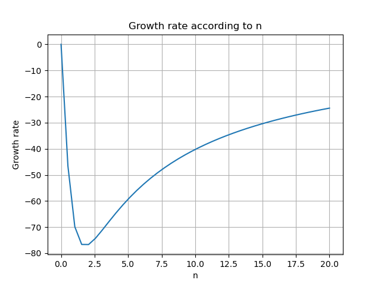
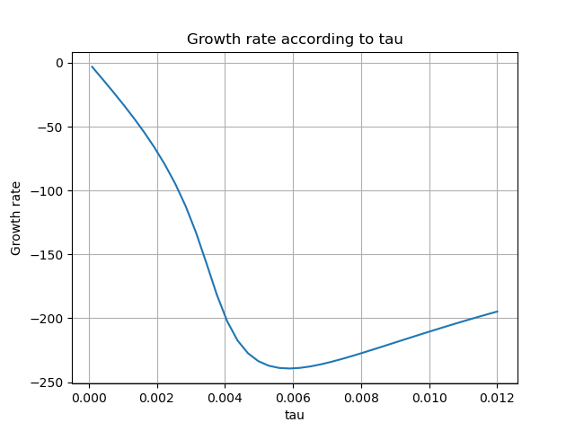
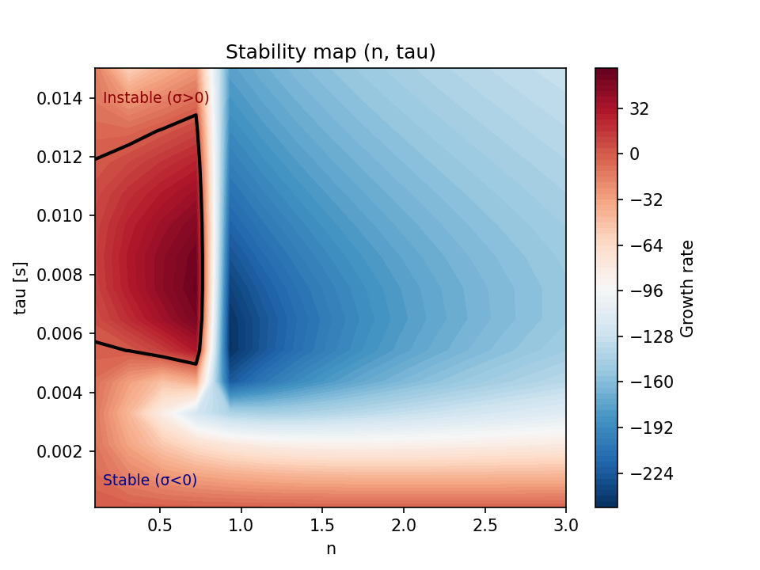

# Physical Formulation

## 1. Chemical kinetics and laminar flame calibration

The laminar flame speed and adiabatic flame temperature of the fresh CH4/air
and H2/air mixtures are computed with Cantera, using a freely-propagating
premixed flame (`FreeFlame`) solved with the GRI-Mech 3.0 mechanism for
methane and a dedicated H2/air mechanism for hydrogen.

All calculations in this project (validation case and main thermoacoustic
study) use T = 298.15 K and p = 1 atm (101325 Pa) as the reference fresh-gas
conditions, matching standard laboratory conditions (25degC) used throughout
the combustion literature.

These quantities are not the end goal in themselves: they are used later to
calibrate the flame response model (n-tau or flame transfer function) that
drives the thermoacoustic network.

### Reference case: CH4/air, phi = 1.0, T = 298.15 K, P = 1 atm

| Quantity | Value |
|---|---|
| Laminar flame speed | 0.38 m/s |
| Adiabatic flame temperature | 2229.5 K |

### Numerical setup

- Domain width: 0.03 m
- Refine criteria: `ratio=3`, `slope=0.05`, `curve=0.05`
- Solved with `auto=True` (staged energy-off / energy-on / refine)

### Grid convergence study

| Grid points | Refine criteria | Flame speed | Adiabatic T |
|---|---|---|---|
| 34 | Cantera default | 0.42 m/s | 2225.8 K |
| 139 | ratio=3, slope=curve=0.1 | 0.38 m/s | 2229.3 K |
| 253 | ratio=3, slope=curve=0.05 | 0.38 m/s | 2229.5 K |

The flame speed is unchanged between the 139-point and 253-point grids,
confirming grid independence. The default Cantera refine criteria (34 points)
under-resolve the flame front and overpredict the flame speed by ~10%.

The adiabatic temperature is far less sensitive to grid resolution than the
flame speed: it is a global energy-balance quantity, nearly independent of
the local spatial discretization, while the flame speed depends directly on
the gradients and reaction rates inside the thin flame front, which require
a finer mesh to capture accurately.

### Validation against reference

The computed flame speed (0.38 m/s) is compared to the experimental value of
Vagelopoulos & Egolfopoulos (1998), 0.36 m/s +/- 0.017 m/s, measured by the
counterflow twin-flame technique at the same conditions (CH4/air, phi=1.0,
298 K, 1 atm):

> Vagelopoulos, C. M., & Egolfopoulos, F. N. (1998). Direct experimental
> determination of laminar flame speeds. Proceedings of the Combustion
> Institute, 27, 513-519.

The ~5.6% overprediction is consistent with GRI-Mech 3.0's known tendency to
slightly overpredict flame speed near stoichiometry, and is within the
typical scatter (+/-2-3 cm/s) observed between different experimental
techniques reported in the literature (Bunsen burner, heat-flux method,
counterflow, spherical/cylindrical constant-volume vessels).

The computed adiabatic flame temperature (2229.5 K) was cross-checked
against an independent Cantera/GRI-Mech 3.0 implementation (agreement within
0.2%), confirming the correctness of this implementation:

> Adiabatic flame temperatures for oxy-methane, oxy-hydrogen, air-methane,
> and air-hydrogen stoichiometric combustion using the NASA CEARUN tool,
> GRI-Mech 3.0 reaction mechanism, and Cantera Python package. arXiv:2503.11826.

As a physical sanity check, this result is also ~100 K lower than a
simplified complete-combustion estimate without dissociation (2325.6 K,
based on Turns' textbook thermodynamic tables). This is expected: at flame
temperature, dissociation of combustion products (CO, OH, H, O) absorbs
energy and lowers the true equilibrium temperature below the simplified
no-dissociation estimate.

## 2. Acoustic model

The acoustic field inside the duct network is described by 1D linear
acoustics with no mean flow. At any point, the state is the pair (p, u):
acoustic pressure and acoustic velocity. Each duct element maps the state
at its inlet to the state at its outlet via a 2x2 transfer matrix:

    [p]      [ cos(kL)        -i*Z*sin(kL) ] [p]
    [u]_out =[ -i*sin(kL)/Z    cos(kL)     ] [u]_in

where k = omega/c is the wavenumber, L the duct length, and Z = rho*c the
characteristic acoustic impedance of the gas.

Boundary conditions are expressed in the general form a*p + b*u = 0:
- Closed end (rigid wall): u = 0, i.e. (a, b) = (0, 1)
- Open end (idealized, no end correction, no radiation impedance): p = 0,
  i.e. (a, b) = (1, 0)

Eigenfrequencies of the network are found by propagating a state that
satisfies the inlet boundary condition through all elements, and searching
for frequencies at which the outlet boundary condition is also satisfied
(characteristic equation). A frequency sweep is used to locate the minima
of the characteristic value's magnitude.

### Validation: closed-open duct

The solver was validated on a simple closed-open duct (L = 1 m,
c = 343 m/s), for which the analytical eigenfrequencies are known:

f_n = (2n-1) * c / (4L), n = 1, 2, 3, ...

| Mode | Numerical (Hz) | Analytical (Hz) | Relative error (%) |
|---|---|---|---|
| 1 | 86.0 | 85.75 | 0.292 |
| 2 | 257.0 | 257.25 | 0.097 |
| 3 | 429.0 | 428.75 | 0.058 |
| 4 | 600.0 | 600.25 | 0.042 |
| 5 | 772.0 | 771.75 | 0.032 |
| 6 | 943.0 | 943.25 | 0.027 |

All six modes are recovered within 0.3% of the analytical values, confirming
the correctness of the transfer-matrix implementation. The residual error
is purely numerical (finite resolution of the frequency sweep, 1 Hz step
over 1-1000 Hz) rather than a modeling limitation.

This validates the acoustic-only building block of the network, isolated
from any flame response. The full thermoacoustic model (coupled acoustics + flame response) will be validated once the n-tau flame model is implemented (Section 3).

## 3. Flame response model and thermoacoustic coupling

### 3.1 Crocco's n-tau model

The flame's heat release response to acoustic perturbations is modeled
using Crocco's n-tau law: the fluctuating heat release Q' follows the
upstream acoustic velocity u' with a time delay tau and a gain n:

    Q'(t) = n * u'(t - tau)

In the frequency domain, this becomes:

    Q'(omega) = n * exp(-i*omega*tau) * u'(omega)

### 3.2 Compact flame element

The flame is modeled as compact (zero-thickness) within the acoustic
network. Pressure is continuous across the flame, while the acoustic
velocity jumps in proportion to the fluctuating heat release:

    p_out = p_in
    u_out = u_in + coupling_factor * n * exp(-i*omega*tau) * u_in

which gives the 2x2 transfer matrix:

    [p]      [ 1                                          0 ] [p]
    [u]_out =[ 0    1 + coupling_factor * n * exp(-i*omega*tau) ] [u]_in

Eigenfrequencies of the coupled system are now complex: omega = omega_r +
i*omega_i. The growth rate is defined as sigma = -omega_i, so that
sigma > 0 indicates an unstable (growing) mode and sigma < 0 a stable
(decaying) mode, consistent with the Rayleigh criterion.

Roots of the characteristic equation are found with a Newton-Raphson
solver (`scipy.optimize.newton`), starting from an initial guess close to
the acoustic-only eigenfrequency and updated progressively as the flame
parameters are varied.

### 3.3 Consistency check: n = 0 limit

As a sanity check, setting n = 0 (flame heat release does not respond to
acoustic perturbations) should recover the acoustic-only eigenfrequency
found in Section 2, with zero growth rate. This was confirmed numerically:

| Case | omega (rad/s) | Frequency (Hz) | Growth rate |
|---|---|---|---|
| Acoustic-only (Section 2) | 538.78 | 85.75 | 0 (by construction) |
| Coupled, n=0 | 538.78 - 3.8e-21j | 85.75 | ~0 (numerical noise) |

This confirms that the CompactFlame element reduces exactly to a neutral
(non-coupling) element when the flame's heat release response is switched
off, validating the implementation.

### 3.4 Preliminary 1D parameter sweeps

Before exploring the full (n, tau) parameter space, two 1D sweeps were
performed as an exploratory step, at fixed geometry (tube_length=1m,
flame_position=0.25m).

At fixed tau=2ms, the growth rate remains negative (stable) over the
whole tested range of n (0 to 20), with a minimum (most stable point)
around n=1.5-2.

At fixed n=1, the growth rate also remains negative over the tested range
of tau (0 to 12ms), though a non-monotonic trend is visible.

Neither 1D sweep revealed an unstable configuration: as predicted by the
Rayleigh criterion, instability depends on the phase relationship between
heat release and pressure (controlled jointly by n and tau), not on
either parameter in isolation. This motivated the full 2D exploration
below.

### 3.5 Stability map (n, tau)

A full 2D sweep over n in [0.1, 3] and tau in [0.1, 15] ms was performed,
solving for the fundamental mode's complex eigenfrequency at each (n,
tau) combination.

This reveals a clear unstable region (sigma > 0) at low tau (below ~4-5
ms) across most of the tested range of n, separated from a stable region
at higher tau by a sharp, nearly vertical boundary. This structure is
consistent with the physical mechanism described by the Rayleigh
criterion (phase relationship between heat release and pressure
fluctuations), confirmed explicitly in Section 3.6.

### 3.6 Rayleigh criterion verification

To confirm that the sign of the growth rate obtained from the eigenvalue
solver is physically consistent with the Rayleigh criterion, the
Rayleigh index (proportional to Re(p'* x Q') at the flame location) was
computed directly for two representative cases and compared to the
sign of the growth rate:

| Case (n, tau) | Growth rate sigma [1/s] | Rayleigh index (sign) | Signs match |
|---|---|---|---|
| (0.1, 7 ms) — unstable region | +7.69 | +0.0001 | Yes |
| (1.0, 2 ms) — stable region | -69.20 | -0.0006 | Yes |

In both cases, the sign of the growth rate matches the sign of the
Rayleigh index, confirming that the eigenvalue solver correctly captures
the phase relationship between heat release and pressure fluctuations
predicted by the Rayleigh criterion: heat release in phase with pressure
(positive Rayleigh index) drives the instability, consistent with the
physical mechanism underlying thermoacoustic instabilities.

## 4. Stability criterion

(Rayleigh criterion — to complete)

## References

1. Vagelopoulos, C. M., & Egolfopoulos, F. N. (1998). Direct experimental
   determination of laminar flame speeds. *Proceedings of the Combustion
   Institute*, 27, 513-519.
   — Experimental reference for the CH4/air laminar flame speed
   (counterflow twin-flame technique).

2. Adiabatic flame temperatures for oxy-methane, oxy-hydrogen, air-methane,
   and air-hydrogen stoichiometric combustion using the NASA CEARUN tool,
   GRI-Mech 3.0 reaction mechanism, and Cantera Python package.
   arXiv:2503.11826.
   — Independent Cantera/GRI-Mech 3.0 implementation used to cross-check
   the correctness of this project's flame calibration script.

3. Turns, S. R. *An Introduction to Combustion: Concepts and Applications.*
   — Simplified complete-combustion (no dissociation) adiabatic flame
   temperature estimate, used as a physical sanity check.
